

<picture><source media="(prefers-color-scheme: dark)" srcset="assets/hero-dark.svg"></picture>

<picture><source media="(prefers-color-scheme: dark)" srcset="assets/social-l-dark.svg"></picture><a href="https://discord.com/gnort67"><picture><source media="(prefers-color-scheme: dark)" srcset="assets/social-1-dark.svg"></picture></a><a href="https://x.com/"><picture><source media="(prefers-color-scheme: dark)" srcset="assets/social-2-dark.svg"></picture></a><a href="https://github.com/minhtrong67"><picture><source media="(prefers-color-scheme: dark)" srcset="assets/social-3-dark.svg"></picture></a><picture><source media="(prefers-color-scheme: dark)" srcset="assets/social-r-dark.svg"></picture>

<picture><source media="(prefers-color-scheme: dark)" srcset="assets/about-dark.svg"></picture>

<picture><source media="(prefers-color-scheme: dark)" srcset="assets/stack-dark.svg"></picture>

<a href="https://github.com/minhtrong67/my-web-apps"><picture><source media="(prefers-color-scheme: dark)" srcset="assets/project-my-web-apps-dark.svg"></picture></a>&nbsp;<a href="https://github.com/minhtrong67/my-tauri-apps"><picture><source media="(prefers-color-scheme: dark)" srcset="assets/project-my-tauri-apps-dark.svg"></picture></a>

<a href="https://github.com/minhtrong67/my-kotlin-apps"><picture><source media="(prefers-color-scheme: dark)" srcset="assets/project-my-kotlin-apps-dark.svg"></picture></a>&nbsp;<a href="https://github.com/minhtrong67/my-rust-apps"><picture><source media="(prefers-color-scheme: dark)" srcset="assets/project-my-rust-apps-dark.svg"></picture></a>

<a href="https://github.com/minhtrong67/my-chrome-extensions"><picture><source media="(prefers-color-scheme: dark)" srcset="assets/project-my-chrome-extensions-dark.svg"></picture></a>&nbsp;<a href="https://github.com/minhtrong67/my-cli-tools"><picture><source media="(prefers-color-scheme: dark)" srcset="assets/project-my-cli-tools-dark.svg"></picture></a>

<picture><source media="(prefers-color-scheme: dark)" srcset="assets/stats-dark.svg"></picture>

<picture><source media="(prefers-color-scheme: dark)" srcset="assets/streak-dark.svg"></picture>

<picture><source media="(prefers-color-scheme: dark)" srcset="assets/wave-dark.svg"></picture>

<a href="https://example.com"><picture><source media="(prefers-color-scheme: dark)" srcset="assets/button-1-dark.svg"></picture></a>&nbsp;&nbsp;<a href="https://github.com/minhtrong67?tab=repositories"><picture><source media="(prefers-color-scheme: dark)" srcset="assets/button-2-dark.svg"></picture></a>

<a href="https://metawka.github.io/expressive-profile/?from=minhtrong67"><picture><source media="(prefers-color-scheme: dark)" srcset="assets/credit-dark.svg"></picture></a>

<!-- AWAKEN:START -->
<!-- Generated by git-profile-awaken. Edit awaken.json instead of this block. -->







<a href="https://github.com/minhtrong67/my-kotlin-apps"></a>
<a href="https://github.com/minhtrong67/my-tauri-apps"></a>

<a href="https://github.com/minhtrong67/my-rust-apps"></a>
<a href="https://github.com/minhtrong67/my-web-apps"></a>




<!-- AWAKEN:END -->
